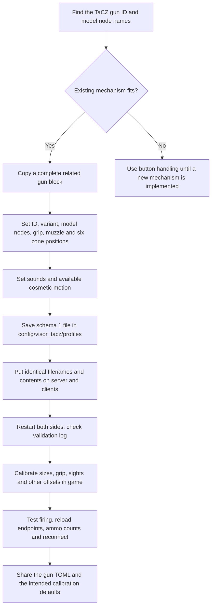
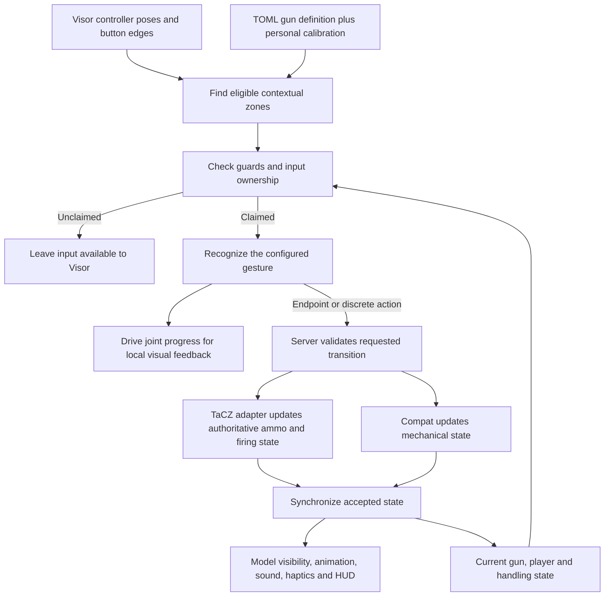

# Gun authoring: current workflow and proposed configurable interactions

This document distinguishes the implemented schema 1 from a proposed schema 2.
Schema 2 below is a design sketch, not accepted by the current mod. No runtime
changes are implied by this document.

## Add a gun today



Start with the complete Glock block in `src/main/resources/gun-profiles.toml`
for a related magazine pistol. Keep its compatible mechanism and variant while
changing the ID and geometry. A variant is not a free-form gun name: it selects
existing Java behavior. A conventional rifle can use the `MAGAZINE` variant.

Each custom file starts with `schema = 1`. Copy the complete `[[guns]]` entry and
all its tables. File location is relative to the actual Minecraft instance:
`config/visor_tacz/profiles/my-pack.toml`.

The six recognized zones are magazine, rack, support, release, selector and port.
Positions are unscaled gun-local metres: +X right, +Y up, +Z rearward. Model
grip/muzzle inputs use model pixels. The calibration overlay and gun scale apply
after these defaults. Reload Calibration currently reloads JSON, not gun TOML.

## What is implemented

| Concern | Current implementation | Proposed schema 2 |
|---|---|---|
| Zone position | TOML plus personal calibration offsets | Same, with explicit coordinate frame |
| Zone dimensions | Calibration JSON | TOML defaults plus personal overrides |
| Independent zone rotation | No general rotated-zone definition | Oriented boxes; declared angle convention |
| Zone follows moving part | Specific template behavior | Attach to a named part/joint |
| Zone action | Fixed by template and zone name | Bind a zone to a named action |
| Gesture direction/travel | Implemented in Java mechanisms | Select a recognizer and configure its parameters |
| Start inside, enter, cross opposite face | Not generally configurable | Explicit start/entry/exit conditions |
| Required buttons/hand | Handling settings and Java behavior | Hand role, button edges/holds/chords |
| Disabled under water, airborne, crouched | Existing code-specific conditions | Explicit action guards |
| Joint axis/limits | Template controlled | Linear and rotational joint primitives |
| Slide firing motion | TOML node and cosmetic travel | Bind visuals to joint progress/state |
| Cylinder/hammer/round meshes | Existing TOML visual fields | Explicit visibility and motion bindings |
| Ammo and chamber mutations | Server Java mechanisms and TaCZ API | Named, validated semantic actions |
| Arbitrary new mechanic | Requires Java | Still needs Java if no existing primitive represents it |

Schema 1 rejects custom joints, zone fields other than position, and custom
bindings/poses/transitions. Do not paste schema 2 examples into a live profile.

## Proposed interaction pipeline



A zone is a place, a gesture is an input rule, a joint is allowed motion, and an
action is a gameplay operation. Keep these separate. Moving a mesh must never
silently change ammunition. Reaching a joint endpoint requests one action; the
server accepts or rejects it, then visuals reflect the accepted state.

## Proposed example: hold a slide and pull rearward

Illustrative only. Numbers are examples, not calibrated defaults or a complete file.

```toml
schema = 2

[[guns]]
id = "example:service_pistol"
template = "closed_bolt_magazine"

[guns.zones.slide_grab]
frame = "part:slide"
position_m = [0.0, 0.025, 0.0]
size_m = [0.07, 0.05, 0.12]
rotation_deg = [0.0, 0.0, 0.0]

[guns.joints.slide]
part = "slide"
kind = "linear"
frame = "gun"
axis = [0.0, 0.0, 1.0] # rearward in our gun frame
limits_m = [0.0, 0.055]
return_mode = "spring_unless_locked"

[[guns.bindings]]
id = "rack_slide"
zone = "slide_grab"
hand = "free_hand"
button = "grip"
activation = "press_inside"
gesture = "drag_axis"
joint = "slide"
origin = "hand_at_acquisition"
scale = 1.0
retain_margin_m = 0.12
allowed_modes = ["physical", "advanced"]
allowed_states = ["ready", "needs_cycle", "magazine_removed"]
guards = ["tracking_valid", "gun_owned", "not_reloading_native"]
on_rear_endpoint = "action.extract_chamber"
on_front_endpoint = "action.feed_if_possible"
rearm = "opposite_endpoint"
consume = "while_owned"
```

`press_inside` would accept a fresh Grip press anywhere inside the box and measure
motion from that hand position. It differs from `enter_while_held`, which allows
acquisition after entering with Grip already held. A slap recognizer would instead
specify entry face, exit face, direction, minimum travel/speed and maximum duration.
Swept segment tests between successive poses are needed so a fast hand cannot
skip a thin zone. A gun-local frame must also account for gun motion so moving the
entire gun does not count as operating the part.

The example attaches acquisition to the slide but measures the joint in the gun
frame. Once acquired, ownership must persist through the stroke; a small grab box
must not force the hand to stay inside its original acquisition location.

## State and TaCZ mapping

Prefer several related state variables over one huge enum: magazine inserted,
action progress/lock, chamber occupancy, jam, support ownership and handling mode.
Templates constrain valid combinations. Transitions must specify completion,
interruption, cancellation and recovery, not only the happy path.

| Semantic action/readout | Owner and meaning |
|---|---|
| Read ammunition/chamber | TaCZ native ammo count and barrel-loaded flag, interpreted by the mechanism adapter |
| Remove/insert magazine | Compat physical state plus existing server ammo reservation/reload operations |
| Extract/feed chamber | Server mechanism transaction; conserve live rounds and distinguish spent cases |
| Cylinder contents | Native ammo plus compat spent-round data today; per-chamber identities would be a separate feature |
| Fire | Native TaCZ firing contract, subject to compat locks, jam, ownership and pose validation |
| Semi/burst/auto selector | Request a fire mode supported by that gun; never invent a mode absent from the pack |
| ADS | Native aim request with VR alignment/support and movement guards |
| Animate slide/hammer | Visual state/progress; never an ammo transaction by itself |
| Display visible cartridges | A view of accepted state, not an authoritative ammo counter |
| Pass input to Visor | Do not consume the input unless the action successfully claims ownership |

For a magazine inserted while the slide is open, rendering should independently
show an inserted magazine, an open slide and the appropriate visible ammunition.
No universal TaCZ animation variable can represent every mechanical combination.
Some meshes do not contain individual round nodes: TOML cannot create missing art.

## Additional rules needed before schema 2 is practical

- Stable IDs, schema versions, units, angle order, coordinate frames and left-hand
  mirroring. Avoid numerical indexes for model parts.
- Acquisition versus retention volumes; priority when zones overlap; exclusive
  hand/input ownership. Do not steal another addon's already-owned held Grip.
- Gesture debounce, endpoint rearming, fast-motion crossing detection, hysteresis
  and tracking-loss cancellation. One stroke must not eject a round every frame.
- Per-action guards for swimming, ground state, crouching, holstering, native
  reload and VR focus. Defaults should not globally forbid plausible interactions.
- Server validation and synchronization; profiles must agree on gameplay rules.
  Personal fit calibration remains a separate overlay with bounded values.
- Inventory conservation, death/disconnect/save/rejoin recovery, and removal of
  the addon. Runtime ammo state belongs in the save, never in a shared gun TOML.
- Sound, haptics, debug guides and per-gun help as feedback bindings.
- Validation that points to the gun, field and reason; an inspector explaining
  why an action is unavailable, plus preview of joint endpoints and zone motion.
- Atomic profile reload: validate first, then replace at a safe boundary. Do not
  change a mechanism under an in-progress reload without a recovery policy.

## Suggested implementation order

1. Add TOML zone dimensions, rotations and joint limits with previews, preserving
   the current tested mechanisms.
2. Expose existing gesture recognizers, guards and input ownership through named
   bindings. Migrate Glock and prove identical behavior first.
3. Add restricted transitions calling validated semantic actions. Exercise pump,
   lifted bolt and cylinder mechanisms before promising general gun-pack support.
4. Add new recognizers or ammo adapters in Java only when existing primitives
   cannot represent the requested mechanism.

Most future gun support could then be file-only. A configuration language still
needs an engine: TOML describes which supported operations to combine; it does
not implement novel mechanics on its own.
