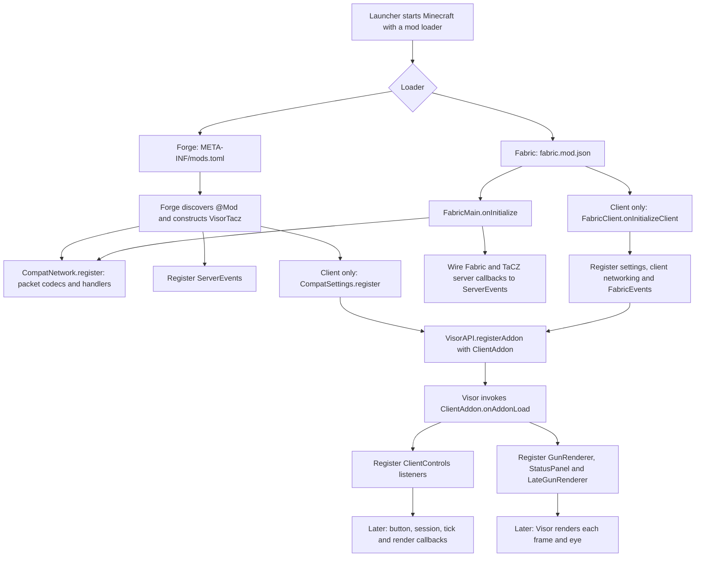
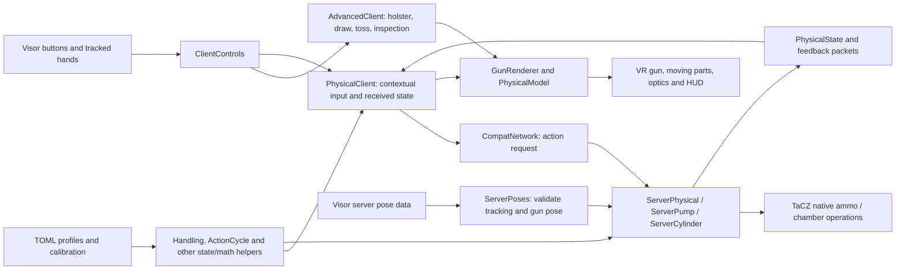
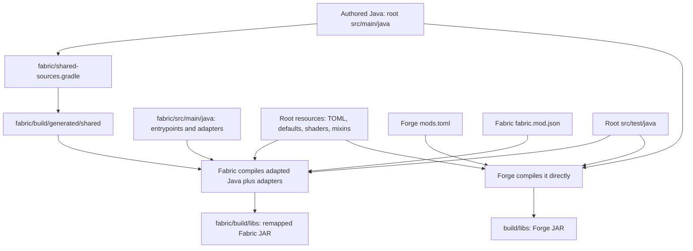

# Developer tour: where to start

This guide describes the source layout inspected on 2026-10-06. Start here if you
can read Java but have not written a Minecraft mod. Older release paragraphs and
design documents describe earlier snapshots; the implementation and build files
are the authority for current behavior.

## 1. Why there is no main()

Minecraft is the application. Forge or Fabric loads our JAR into Minecraft and
calls our entrypoint. We register callbacks, then return control to the game.
There is no loop in our mod that calls every feature in order.

For Forge, open [VisorTacz.java](../src/main/java/dev/visorcompat/tacz/VisorTacz.java):

```java
@Mod(VisorTacz.ID)
public final class VisorTacz {
    public VisorTacz() {
        CompatNetwork.register();
        MinecraftForge.EVENT_BUS.register(ServerEvents.class);
        DistExecutor.safeRunWhenOn(Dist.CLIENT, () -> ClientRegistration::register);
    }
}
```

The `@Mod` annotation identifies our entrypoint. Forge constructs this class.
The constructor registers network messages and server event handlers. On a client
it also registers settings and our Visor addon. A dedicated server does not run
the client registration branch.

For Fabric, the entrypoint names are explicit in
[fabric.mod.json](../fabric/src/main/resources/fabric.mod.json):

- `main` calls [FabricMain.onInitialize()](../fabric/src/main/java/dev/visorcompat/tacz/fabric/FabricMain.java).
- `client` calls [FabricClient.onInitializeClient()](../fabric/src/main/java/dev/visorcompat/tacz/fabric/FabricClient.java) on a client.

The Fabric JSON key `main` means a loader entrypoint; it does not require a Java
`public static void main(String[] args)` method.

## 2. Startup and ongoing execution



This shows registration dependencies, not a strict ordering of every loader
operation. Forge also automatically registers classes annotated with
`@Mod.EventBusSubscriber`; they are not all called from `VisorTacz`.
`CompatSettings`, `AutoAds`, and other subscribers are examples.

Mixins are a separate integration path. The loader configures
[visor_tacz.mixins.json](../src/main/resources/visor_tacz.mixins.json), and Mixin
patches target classes as they load. The Forge JAR advertises this configuration
in its manifest; Fabric advertises it in its metadata. A mixin method may run
because TaCZ or Visor calls its own code, without any normal Java caller in this
repository.

Three kinds of callback matter:

| Callback | When it happens | Example |
|---|---|---|
| Input or lifecycle event | A button changes, VR focus changes, or a player connects | `ClientControls.onAction`, `ClientControls.session` |
| Game tick | Minecraft advances simulation; normally 20 ticks per second | `ClientControls.tick`, `ServerEvents.tick` |
| Render callback | A frame or VR eye is drawn; rate depends on rendering | `ClientControls.animation`, `GunRenderer.render` |

`@SubscribeEvent` denotes a Forge event handler. `@VREventHandler` denotes a Visor
event handler. `@Inject` and related annotations denote Mixin hooks. Use these
as navigation landmarks when a method appears to have no callers.

## 3. The architecture during gameplay



The client knows what the local hands/buttons are doing and supplies responsive
visuals. The server checks whether an action is valid and owns gameplay changes.
An on-screen moving slide does not itself chamber a round. Network requests are
checked against server-side state and pose data.

Single-player still has both sides: the client and an integrated server run in
the same application, on different threads. Consequently, changing only a
client animation can make something look correct while ammo behavior stays
wrong. Client-only APIs such as `Minecraft.getInstance()` belong in client code;
a dedicated server has no local player, screen, or VR rendering context.

### Follow a real physical grip

1. Visor calls `ClientControls.onAction(event)`.
2. Advanced handling gets the first opportunity through `AdvancedClient.action`;
   then `PhysicalClient.action` considers contextual handling. Consuming an event
   prevents the ordinary fallback for that input.
3. `PhysicalClient.target()` uses the hand's gun-local position and `Handling`
   geometry to identify a magazine, rack, support grip, pouch, etc.
4. The client sends `new CompatNetwork.PhysicalGrip(true)`.
5. The registered packet handler calls `ServerPhysical.grip(player, true)`, or
   cylinder handling where appropriate. The server independently checks the
   player, gun, mode, hand availability, pose and target.
6. `ServerEvents.tick()` advances `ServerPhysical.tick()`. Pump and cylinder guns
   route to their dedicated controllers. Motion can change the phase or invoke
   native ammo/chamber operations.
7. The server sends `PhysicalState`; `PhysicalClient.receive()` adopts it.
   `GunRenderer` and `PhysicalModel` use the state to show moving or hidden parts.

Controller poses already travel through Visor's networking. `PhysicalGrip` is
an action request, not a packet carrying every hand position.

### Follow a shot

`ClientControls` drives TaCZ's native shooting controller. TaCZ's own networking
handles firing; this addon does not introduce a second independent fire packet.
`ServerEvents.beforeShot/beforeRound` gate invalid VR shots.
[BulletMixin](../src/main/java/dev/visorcompat/tacz/mixin/BulletMixin.java) sets the
spawn origin from the validated muzzle and notifies recoil/physical state;
`BulletSpreadMixin` handles the VR direction/spread integration. TaCZ continues
to own its native firing, ammunition, damage, and other weapon rules.

## 4. Files to know, grouped by responsibility

Java paths below are relative to `src/main/java/dev/visorcompat/tacz/` unless
otherwise stated. You do not need to understand every helper before editing.

| Area / files | Responsibility |
|---|---|
| `VisorTacz.java` | Forge entrypoint and initial registration |
| `client/ClientAddon.java` | Registers our input listeners and render effects with Visor |
| `client/ClientControls.java` | Input ownership, native shooting, lifecycle cleanup and animation updates |
| `client/CompatSettings.java` | Settings, handling mode, `/visor_tacz` commands and synchronization with the server |
| `client/PhysicalClient.java` | Contextual physical controls, local targeting and server state reception |
| `client/AdvancedClient.java` | Experimental holsters, hand ownership, toss/catch and inspection |
| `network/CompatNetwork.java` | Packet types, serialization, dispatch and per-player synchronized preferences |
| `server/ServerEvents.java` | Server tick/fire/reload callbacks and jam test command |
| `server/ServerPhysical.java` | Magazine/rack/support state controller, native reload bridge and recovery |
| `server/ServerPump.java`, `server/ServerCylinder.java` | Shotgun pump/shell and cylinder/breech handling |
| `server/ServerAdvanced.java`, `server/ServerJams.java` | Advanced action validation and jam integration |
| `server/ServerPoses.java` | Validates Visor tracking, gun pose, reach and wall obstruction |
| `server/RemoteSync.java`, `client/RemoteGuns.java`, `client/AdvancedRemote.java` | Other players' gun state and rendering |
| `physical/Handling.java` | Phase/target enums, interaction geometry and contextual eligibility |
| `physical/ActionCycle.java`, `PumpCycle.java`, `CylinderCycle.java`, `Chamber.java` | Small reusable state transitions and rules; useful starting points for reading/tests |
| `GunPose.java`, `PoseMath.java`, `HandAnchor.java` | Turns tracked controllers, support hands and calibration into position/rotation/muzzle direction |
| `client/GunRenderer.java`, `LateGunRenderer.java` | Renders native TaCZ gun models in the VR rendering pipeline |
| `client/PhysicalModel.java`, `CosmeticParts.java` | Temporarily moves/hides model nodes to represent action and cosmetic state |
| `client/OpticRenderer.java`, `AutoAds.java` | Optic rendering and physical sight alignment driving ADS |
| `RecoilMotion.java`, `client/ClientRecoil.java`, `server/ServerRecoil.java` | Shared recoil math, visual application and authoritative shot direction/lifecycle |
| `physical/MagazineMotion.java`, `client/MagazineEffects.java` | Constrained magazine release and cosmetic loose-magazine motion |
| `client/StatusPanel.java`, `StatusHud.java` | Gun/wrist and normal GUI status displays |
| `client/ControlsScreen.java`, `AdvancedScreen.java` | Main settings and advanced handling menus |
| `client/*Screen.java`, `*Store.java` | Calibration editors and preview/load/save behavior |
| `Calibration.java`, `ZoneSizes.java`, `InteractionOffsets.java` | Gun fit, dimensions and interaction offsets |
| `PhysicsCalibration.java`, `HolsterCalibration.java`, `InspectionCalibration.java` | Separate physics/holster/inspection data |
| `Profiles.java`, `DescriptorProfiles.java`, `WeaponProfile.java`, `PistolProfiles.java` | Resolves an item into a validated TOML-defined profile and asset metadata |
| `compat/GunDurabilityCompat.java` | Optional durability-mod bridge |
| `mixin/*.java` | Hooks inside TaCZ, Visor and Minecraft when public callbacks are insufficient |

`PistolProfiles` is now a view of parsed descriptor data, not a second handwritten
per-pistol catalog. `WeaponProfile.Mechanism` still selects implemented Java
engines/variants. TOML describes guns using these engines; it does not replace
their Java behavior with a scripting language.

### Resources and configuration are different layers

| File / path | What it controls |
|---|---|
| `src/main/resources/gun-profiles.toml` | Shared bundled gun definitions: mechanism, model nodes, geometry, zone positions, sounds and visual metadata |
| Instance `config/visor_tacz/profiles/*.toml` | External additions/overrides; same supported schema, identical files required on client/server |
| `src/main/resources/calibration-defaults.json` | Bundled starting gun calibration |
| `src/main/resources/holster-defaults.json`, `inspection-defaults.json` | Bundled starting holster and inspection calibration |
| `src/main/resources/calibration-hints.toml` | Per-gun calibration instructions |
| Instance `config/visor_tacz-calibration.json` | Player's saved gun/zone fit; matching entries override bundled profiles |
| Instance `config/visor_tacz-holsters.json`, `visor_tacz-inspections.json`, `visor_tacz-physics.json` | Player's other saved calibrations |
| Instance `config/visor_tacz-client.toml` | Menu preferences registered by `CompatSettings` |
| `src/main/resources/META-INF/mods.toml` | Forge identity and allowed dependency versions |
| `fabric/src/main/resources/fabric.mod.json` | Fabric identity, entrypoints and allowed dependency versions |
| `src/main/resources/visor_tacz.mixins.json` | Common/client mixin class lists |
| `src/main/resources/assets/visor_tacz/shaders/core/optic.*` | Optic shader program and its configuration |

The three `src/main/resources/visor_tacz-*.json` calibration import files are
explicitly excluded from both JARs. The `*-defaults.json` files are the bundled
resources. Copying a personal file into the source tree does not automatically
make it the default. Merge/import it into the corresponding defaults file while
preserving other gun entries, then rebuild.

`DescriptorProfiles` loads lazily on first use: bundled TOML, then external TOML
files in filename order. Later entries replace earlier entries for the same gun
ID. Invalid input disables the catalog rather than installing part of it. It
loads once per process; changing TOML requires restarting Minecraft/server.
Reload calibration reloads calibration JSON, not the gun catalog.

Geometry fields such as `grip_pixels` use native model units. Zones use gun-local
metres: +X right, +Y up, +Z rearward. JSON translations use metres and rotations
use degrees. Do not assume all three representations use the same units.
Consult [RUNTIME-PROFILES.md](RUNTIME-PROFILES.md) for the accepted schema.

Persistent gun state is a third concern: native TaCZ state and some compatibility
tags belong to the gun's `ItemStack`, which Minecraft saves with inventory. Live
per-player sessions are temporary maps and are cleared/recovered across lifecycle
events. Menu JSON is not a world save or an ammo database.

## 5. Forge versus Fabric: what is shared?

We have **one authored gameplay/catalog source**, with **two loader integrations
and two builds**. The shared code is still Forge-oriented; this is not yet a
fully loader-neutral `common` module.



`fabric/shared-sources.gradle` generates an adapted copy at build time. It replaces
Forge imports/API calls, removes Forge event annotations, adjusts registration
and makes selected mixin remapping changes. It excludes the root `VisorTacz`
entrypoint; Fabric supplies its own ID-holder class with the same package/name.
**Never edit `fabric/build/generated/shared`: the next generation overwrites it.**

| Concern | Forge | Fabric |
|---|---|---|
| Entry | `@Mod` constructor | `ModInitializer` / `ClientModInitializer` |
| Events | Forge bus and subscriber annotations | Explicit callbacks in `FabricMain` / `FabricEvents` |
| Networking | Forge `SimpleChannel` | Our adapter under `fabric/.../network`, using Fabric networking |
| Configuration | Forge config API | Forge Config API Port |
| Rendering adapters | Forge/TaCZ renderer and Oculus paths | Fabric/TaCZ renderer and Iris paths |
| Build | Root `build.gradle`, ForgeGradle | `fabric/build.gradle`, Loom and runtime remapping |

A shared bug fix normally starts in root Java and benefits both builds. A new
Forge event handler does **not** automatically gain Fabric wiring: update
`FabricMain` or `FabricEvents` as needed. New Forge-specific API usage may require
a transformation or adapter. This textual transformation is a maintenance
constraint; compilation and runtime behavior must both be checked.

Dependency coordinates in each `build.gradle` select what we compile against.
Metadata dependency ranges select which installed versions the loader permits.
Relaxing a range does not change the APIs we compiled against or prove that an
older runtime works. The two builds also currently have independently declared
release version strings.

## 6. Build, test, and workspace files

| Path | Purpose |
|---|---|
| `build.gradle`, `fabric/build.gradle` | Dependencies, release version, compilation, resources, test/package tasks |
| `settings.gradle`, `fabric/settings.gradle` | Gradle project names and plugin repositories; Fabric is a separate Gradle project |
| `gradlew.bat`, `gradlew`, `gradle/wrapper/*` | Pinned Gradle wrapper; run from a terminal |
| `gradle.properties`, `fabric/gradle.properties` | Gradle JVM/daemon settings |
| `src/test/java` | Shared JUnit tests; useful examples of expected state/math/file behavior |
| `fabric/production-smoke.gradle` | Launches the packaged/remapped Fabric JAR in a production-style desktop environment |
| `docs/` | Guides, test checklists, historical release notes and designs |
| `experiments/` | Prototypes/design examples; not the accepted runtime TOML schema |
| `.upstream/` | Downloaded/reference upstream material; useful for inspecting TaCZ assets |
| `tools/`, `scripts/` | Diagnostic utilities and asset checks, not startup entrypoints |
| `build/`, `fabric/build/`, `.gradle/` | Generated output/cache; not authored source |
| `run/`, `fabric/run/` | Development instances, potentially including settings and worlds |
| `player-logs/`, `logs/`, `*.log` | Diagnostic evidence; not part of compiled gameplay |

From a PowerShell terminal:

```powershell
cd E:\visor-compat\visor-compat-tacz
$env:JAVA_HOME = 'C:\Program Files\Java\jdk-17'

# Tests only, or one useful test class
.\gradlew.bat test --console=plain
.\gradlew.bat test --tests 'dev.visorcompat.tacz.ActionCycleTest' --console=plain

# Forge JAR
.\gradlew.bat build --console=plain

# Fabric JAR, using the same gameplay source/resources/tests
.\gradlew.bat -p fabric build --console=plain
```

Use `--offline` when the required dependencies are already cached. Forge JARs
go to `build/libs`; installable remapped Fabric JARs go to `fabric/build/libs`.
Development launches use `runClient`/`runServer` in the respective project.
Fabric additionally has `productionClient` to test the packaged runtime JAR;
read [fabric/README.md](../fabric/README.md) before using it. It opens a desktop
client and does not establish Pico/Android or headset gameplay compatibility.

Build/tests do not validate controller reach, stereo optics, all multiplayer
behavior or every upstream mod version. Use [TESTING-CURRENT.md](TESTING-CURRENT.md)
for the headset checklist after relevant changes.

## 7. A practical reading and editing route

Read these in order rather than opening the largest file first:

1. `VisorTacz.java`: see what is registered at startup.
2. `client/ClientAddon.java`: see how Visor learns about our controls/rendering.
3. `client/ClientControls.java`: follow one event through `onAction()` and `tick()`.
4. `client/PhysicalClient.java`: follow `target()`, `action()` and `receive()`.
5. `network/CompatNetwork.java`: find the `PhysicalGrip` request and `PhysicalState` reply handlers.
6. `server/ServerPhysical.java`: follow `grip()`, `tick()`, then the appropriate mechanism controller.
7. `physical/ActionCycle.java` and `src/test/java/dev/visorcompat/tacz/ActionCycleTest.java`: study a small rule with explicit inputs/outputs.
8. `client/GunRenderer.java` and `PhysicalModel.java`: connect gameplay state to model appearance.
9. `Profiles.java`, `DescriptorProfiles.java` and `gun-profiles.toml`: see how one gun selects the behavior you followed.
10. `FabricMain`, `FabricClient`, `FabricEvents` and `shared-sources.gradle`: see how the same behavior is wired on Fabric.

In an IDE, use Go to Definition, Find Usages and breakpoints. Find Usages alone
does not reveal event-bus or mixin calls: also search annotations and Fabric
callback registration. For example:

```powershell
rg -n 'onAction|PhysicalGrip|PhysicalState' src/main/java
rg -n '@SubscribeEvent|@VREventHandler|@Inject' src/main/java
rg -n 'ServerEvents::|controls.tick|controls.animation' fabric/src/main/java
```

| Desired change | Start with |
|---|---|
| Add a gun using an existing mechanism | `gun-profiles.toml`, native TaCZ model nodes, `RUNTIME-PROFILES.md`, `GUN-AUTHORING-MAP.md` |
| Adjust default fit or interaction dimensions | `*-defaults.json`; use in-game calibration to obtain values |
| Change calibration wording | `calibration-hints.toml` |
| Add a setting/menu toggle | `CompatSettings` and the relevant `*Screen`; packets/server behavior if it changes gameplay |
| Change input consumption or Visor fallback | `ClientControls`, `PhysicalClient`, `AdvancedClient`, relevant input mixins |
| Change gesture rules | `physical/*`, its tests, and the server controller that applies the rule |
| Change real ammo/chamber behavior | Server controllers and native TaCZ API integration |
| Change visual travel/part visibility | TOML visual metadata, `PhysicalModel`, `CosmeticParts` |
| Change bullet origin/direction | `GunPose`, `ServerPoses`, recoil and bullet mixins; check both visuals and authoritative shots |
| Fix a loader-specific startup/event failure | Metadata, loader entrypoints/adapters, transformation and packaged mixin remapping |

For a first experiment, override one existing gun's rack-zone position by 1 cm
in a separate TOML file on a spare instance, keeping the complete valid gun
definition. Put identical overrides on both sides and restart. Observe how the
guide and acquisition move. Then read one `ActionCycleTest` case and step through
the Java helper it exercises. These two exercises show the data layer and the
behavior layer without requiring you to understand the whole renderer first.

When adding a genuinely new mechanism, TOML alone is insufficient: implement its
state transition, authoritative ammo effects, input integration, model feedback
and recovery, then expose the supported configuration. The proposed richer schema
in design documents is not an implemented general-purpose behavior engine.
