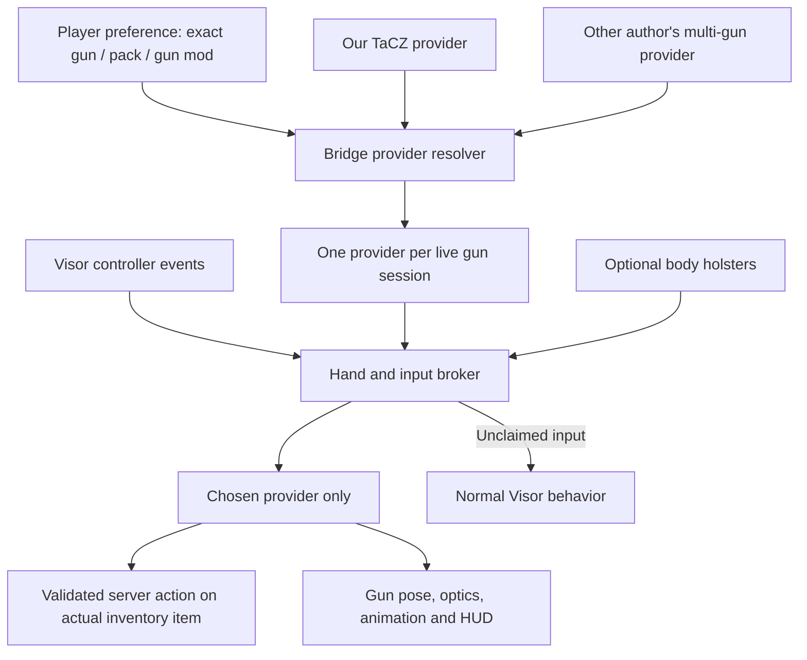

# Visor Gun Bridge — proposed architecture v0

Status: design for agreement with the other author, not a released dependency or a working compatibility guarantee. Existing TaCZ behavior stays available without Bridge. No change to either author's files is assumed.

## Product decision

Use **Visor Gun Bridge** (proposed mod ID `visor_gun_bridge`). It selects the VR mechanics provider for each gun type. It does not load gun packs or replace Fabric/Forge/NeoForge, hence avoid “Loader”. Players can choose our mechanisms for one TaCZ gun and the other author's mechanisms for another. Neither addon has to support every native gun mod.

Keep three modules separate:

1. Bridge API + broker: provider registration, preferences, gun sessions, hand/input ownership, lifecycle, server agreement.
2. Provider adapters: our TaCZ integration and the other author's integration. Each owns its native gun calls, animation, calibration and network actions.
3. Optional body holsters: inventory references and mounts; calls Bridge to draw/stow. It must not depend directly on TaCZ or either provider's reload engine.

Bridge must be usable without the holster addon. Our existing holsters can remain internal until their provider-neutral adapter is ready.



## Selection and identity

An adapter reports `GunKey(nativeMod, packId, gunId)`. Use stable identifiers from native data, never display names; e.g. TaCZ item registry ID alone cannot distinguish Glock from M4. Pack identity is optional when the native mod cannot provide it reliably.

Resolution order: exact gun override, pack default, native-mod default, explicit user-selected general default. An installed supported provider must be chosen deterministically. Missing/incompatible choices show a warning and use the configured fallback (native/no provider by default), never activate both. “Native” is a valid explicit choice. UI lists only providers supporting that gun and indicates supported handling modes.

A preference applies to a gun *type*; execution binds to a real *instance*: player + inventory location + server session generation. Two identical Glocks remain separate sessions. Do not put copied ItemStacks back into inventory. Ordinary ammo/NBT/component updates do not imply replacement; inventory move, replacement, deletion and generation validation belong to the native backend on the server.

## Small public API to agree upon

Illustrative signatures, not final Java ABI:

```java
registerProvider(ProviderId id, ProviderDescriptor descriptor, GunProvider provider);
resolveProvider(PlayerContext player, GunKey gun);
openSession(ValidatedGunRef gun, ProviderId chosen);
boolean owns(GunSession session, ProviderId caller);
ClaimResult tryClaim(GunSession session, PhysicalHand hand, Role role, InputMask inputs);
void releaseClaim(ClaimToken token);
void closeSession(GunSession session, EndReason reason);
```

`GunProvider` supplies support/capability queries, session start/stop, accepted input callbacks, tick, pose/render hooks, and draw/stow requests. Gun-specific state machines stay in that provider. `PhysicalHand` is LEFT/RIGHT, mapped explicitly to Visor MAIN/OFFHAND and handedness. Roles include holding, supporting, action manipulation, held magazine and UI. Tokens are opaque and generation-bound; release can only release one's own token.

Input is negotiated on a fresh press. Providers propose applicable interaction candidates; Bridge resolves existing claims, explicit draw/manipulation and configured precedence before dispatching to one winner. No “first listener wins” dependency. Do not take a hand already owned by a different addon merely because it entered a zone. The winner receives release even outside the zone. Cancellation or disconnect delivers a cancellation callback and neutral state. Passive support may read hand pose without consuming buttons.

A gun's provider owns firing, reload, ADS, recoil, animation and optics together initially. Splitting these across providers creates competing state machines. Read-only HUDs may subscribe separately. Attachment UIs request edits through the owner with the exact gun reference.

## Both authors' required integration

Every participating hook must yield when it does not own the gun: action callbacks, raw-controller polling, automatic reload/shoot loops, native shot direction overrides, recoil/FOV, gun/attachment render hooks, reticles and server events. Cancelling only a button handler is insufficient. Generic mining/Use interception must also check whether Bridge actually claimed that input.

For our repo, introduce one ownership facade first, then route `ClientControls`, `DualClient`, physical/advanced control, native shot/server mixins, `DualGunRenderer`, `OpticRenderer` and cursor suppression through it. With Bridge absent, the facade preserves current behavior. With Bridge present, unowned guns yield entirely. `ServerDual` must eventually hold a provider session per slot rather than assume every selected gun belongs to our engine. Player-wide mode flags cannot be the final ownership boundary.

For the inspected other addon, corresponding seams include `VRHandControls`, `VRTriggerControls`, `TaczControllerFiring`, `EmptyMagazineReload`, `TaczShotRayMixin`, held-item/pose rendering and `VisorTaczCrosshair`. Its local `ButtonPressLease` can delegate accepted leases to Bridge. See OTHER-GUN-MOD-AUDIT.md for static inspection evidence and limits.

The broker cannot undo incompatible mixin injection structure. Each addon must still load successfully with the other installed. Server-side shot overrides need ownership checks too, not just the client's choice.

## Dual wield and the free supporting hand

Resolve each held gun separately. A left-hand Point Blank gun and right-hand TaCZ gun may have different owners. They are allowed together only if both adapters advertise independent-hand support and their native backends can isolate firing/reload state. An addon supporting only native main hand must advertise that limitation; Bridge must explain it rather than silently swap inventory or make both guns fire.

A holstered selected gun does not occupy a physical hand. A held gun does. A provider may borrow the other free hand for reload/support; it cannot steal a hand holding the other provider's gun. To reload with both guns drawn, stow one first unless the provider explicitly implements a one-hand action. Tossing, inspection and temporary support transfer remain owned sessions until completion or cancellation.

Global native FOV and player-wide native reload operators are shared resources. Start with per-eye optic rendering and no competing global FOV ownership. Providers requiring a global reload operator must declare incompatibility with simultaneous independent operations until adapted.

Explicit holster Grab outranks a mere selected-slot reservation, but never steals an actually held gun. A transfer releases the old input lease, changes native selection, binds the new session, then acknowledges success. Failure leaves inventory untouched and cancels the attempted claim. No temporary item copy restoration.

## Network and lifecycle

Server negotiates API version and installed providers, validates supported choices and actual gun references, and authorizes gameplay changes. Client sends intent; ammo/cooldown/reload checks remain server-owned. Providers can retain their packets but must validate the Bridge session generation and ownership on receipt. An absent server provider cannot be selected for authoritative handling.

Preference changes are queued until a safe boundary: released controls, no unresolved inventory transaction. Close old session, release inputs/render ownership, open new provider. Do not reinterpret half-loaded magazines or jam progress through a different engine. Native persisted gun ammo/jam state stays intact; provider-specific transient state must settle or cancel without duplication.

Close/cancel on VR exit, tracking loss, death, disconnect, item deletion, world change and provider disable. Returning to flatscreen restores native selection behavior. Bridge does not promise cross-loader/network compatibility between different native gun implementations.

## Implementation order and acceptance gates

1. Agree names, GunKey/ref schema, hand lease semantics and capability flags with the other author. Build loader-neutral resolver/lease tests in a separate sibling project.
2. Implement optional Bridge facade in both addons. Prove mutually exclusive single-gun input, rendering and native server overrides; missing Bridge preserves standalone operation.
3. Add exact per-gun selection UI/config and server negotiation. Test two different TaCZ guns with different providers, deletion/replacement, reconnect and flatscreen transitions.
4. Extract holster adapter and validate stowed guns/explicit handoff without inventory writes.
5. Enable same-provider dual, then capability-gated mixed-provider dual. Test input release, simultaneous fire/reload, scopes, mirrored handedness, holster handoff and multiplayer.

Do not defer per-gun identity in the API just because the first runtime milestone uses one gun. Do defer mixed-provider dual until both native adapters prove isolation.

## Current release boundary

Alpha.6 fixes below remain within our existing addon; they do not make the inspected other addon compatible automatically. The Bridge is a design artifact awaiting agreed integration. No new required dependency, separate middle-mod JAR, external messages or published standard were created in this change.
