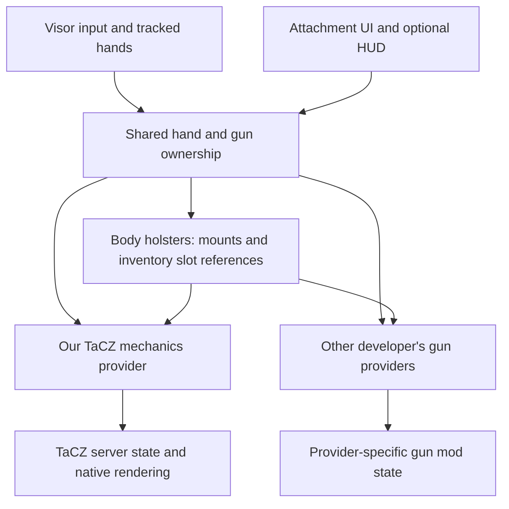

# Visor multi-version architecture and gun-addon interoperability

Update 2026-10-26: [pinned multiplatform template review and staged adoption plan](VISOR-ADDON-MULTIPLATFORM-REVIEW.md).

Review date: 2026-10-16. This is a proposal, not an implemented compatibility guarantee.

Evidence: Visor `dev` commit `89ebd958eeb60aa0892177fe15d55932a5a3d1e8`, the published Visor 0.6.0-beta Forge JAR, our current source, and the user-supplied conversation with the other developer. Their repository/build is not available; their features below are intentions, not verified implementations.

## Recommendation

Adopt Visor's adapter-first approach incrementally. Use Stonecutter when consolidating the build matrix, and retain explicit TaCZ adapters. For cooperation, agree on per-gun and per-hand ownership before extracting the holster module. Do not begin by building a universal gun-mechanics framework or a large mandatory middle mod.

## What Visor actually provides

Visor's current source has three complementary layers:

1. Stonecutter generates Minecraft-version variants from shared source. A TOML target matrix selects versions and loaders, while loader modules package each target separately.
2. The public `api.compatibility.mcversion` package wraps differences in inventory selection, resource identifiers, GUI, vertex building, render targets, shaders and other Minecraft behavior. Conditional source is concentrated in adapters.
3. Public addon components provide input events, tasks, hand poses/effects and lifecycle hooks. `ModLoader` and `VisorChannel` abstract some loader services and networking.

The published 0.6.0-beta Forge JAR contains the inspected `McInventory`, `McVersionUtils`, GUI and rendering wrapper classes. That verifies their presence, not universal compatibility of every method across every published build. The latest development source is newer than the release and must not be used as a substitute for checking the actual target JAR.

The multiplatform addon template currently inspected uses `mod-core`, `mod-fabric` and `mod-forge`; it is not automatically the same as the newer Stonecutter layout in Visor itself.

| Concern | Current addon approach | Visor approach | Consequence |
| --- | --- | --- | --- |
| Gameplay source | One root source, generated target copies | Shared source with version preprocessing | Neither requires duplicating the whole gameplay engine |
| Minecraft differences | Text substitutions plus a growing shared helper | Public wrappers plus localized version branches | Wrappers are easier to review and reuse; text replacements can miss semantic changes |
| Loader differences | Forge-shaped source with Fabric/NeoForge bridges | Loader modules plus public services | We can remove some custom bridges over time |
| Builds | Separate standalone projects | Central version/loader matrix | Centralization improves consistency, but every target still needs validation |
| Native gun integration | TaCZ internals, scripts, models and mixins | No generic replacement for those TaCZ contracts | This remains our responsibility |

Visor's own contributor guidance recommends minimizing conditional code through adapters, compiling all supported versions, committing from the designated active version, and avoiding IDE import cleanup that removes conditional comments.

## Restrictions that remain

- Stonecutter produces separate target builds; it does not make one universal JAR.
- A target still needs compatible TaCZ and Visor releases. Fabric Refabricated and NeoForge TaCZ are distinct upstream ports with potentially different APIs.
- Minecraft 1.21 item components are not merely renamed NBT methods. Reads are snapshots; writes must persist components. Our `StackData` bridge and regression tests remain necessary unless a suitable public wrapper replaces them.
- Bullet-origin hooks, TaCZ animation scripts, scopes, shader passes and gun model parts require target-specific checks. A successful compile cannot prove their runtime mixins are correct.
- We currently reference Visor internals: `TaskHotBar`, `VRServerPlayerImpl`, `VRRenderState` and `HandEffectCrosshair`. Public wrappers do not eliminate those dependencies automatically. Public extension hooks would reduce this risk.
- Adopting newer wrappers may raise the minimum Visor version. Existing 1.20.1 support for older Visor builds needs a compatibility facade or separate maintained target; do not silently add references to classes those builds lack.
- TOML can configure existing mechanisms, zones and calibration. A genuinely new mechanism still needs engine code and tests.
- The public input events and priorities inspected provide routing primitives, not a verified cross-addon per-gun ownership contract. `VRInputRedirect` specifically concerns joystick redirection; it is not a general Grab/Trigger ownership system.

## Evaluate the proposed collaboration

The visions are complementary: our addon focuses on physical TaCZ handling; the other developer proposes broad gun-mod support, crosshairs, attachment UI, empty-trigger reload and immersive optics. The overlap is significant for TaCZ, especially firing, reload, ADS and rendering.

Keeping actions inside each controller helps, but selecting different hotbar items is insufficient. Gun mods can still use player-wide active-hand, reload, animation, FOV and sound state. Our own TaCZ dual-wield implementation required separate native gun contexts for that reason. Mixed TaCZ/Point Blank dual wield remains a separate integration milestone.

| Proposal | Assessment | Required refinement |
| --- | --- | --- |
| Choose which addon controls each supported gun | Good user-facing policy | Both addons must explicitly honor it in input, tick, rendering and server actions |
| Separate body holsters | Good reusable boundary | Holsters own slot references, mount poses, draw/stow and hand claims; providers own native gun behavior |
| Combine one gun from each provider | Useful eventual goal | Require each provider to declare and implement independent offhand support; otherwise disable unsupported combinations clearly |
| Shared attachment menu | Strong early collaboration opportunity | Address a validated gun instance/slot, rather than blindly editing the currently selected main-hand stack |
| Mix individual features from multiple addons | Possible later | Define exclusive capability ownership; do not let two providers simultaneously apply scope/FOV, recoil or reload |

A middle mod cannot neutralize another mod's unconditional mixins, background ticks, or native actions by itself. Cooperation in both addons is mandatory. The first implementation can be a small optional integration API/bridge; a separate shared runtime is justified when both developers adopt the contract. Visor may be the best home for generic hand claims if PhoenixRa wants to expose them, but that is a coordination proposal, not an existing API claim.

## Proposed ownership contract

Use stable gun identifiers and an ephemeral reference to the actual inventory stack/slot, plus a generation token invalidated by replacement, deletion or reassignment. A gun ID alone does not distinguish two Glocks. Avoid cached stack copies that can restore deleted inventory items.

Start with one **mechanics provider per gun instance**, selected from a gun-pack default and exact-gun override. Change providers only at a safe idle/stowed boundary. Observational HUDs may subscribe without consuming input. Optics and attachment UI can become separately negotiated capabilities later.

The conceptual interface needs:

- `supports(stack)` and capabilities: independent offhand, support-hand interaction, mounted rendering, physical reload, optics, attachment editing.
- A held-gun context: physical left/right controller, logical main/offhand mapping, actual inventory reference, mode and lifecycle state.
- A canonical gun/muzzle pose supplied by the mechanics owner. A cooperating crosshair or optic must use that pose, not independently choose the last active controller.
- `draw`, `stow`, `release`, `cancel`, plus a provider rendering hook for mounted and held poses.
- An input claim for a particular hand/action, accepted only on a fresh press inside a zone. Its owner receives release even if the hand leaves the zone.
- A temporary second-hand claim for support or manipulation. A hand already holding another gun cannot also grab this gun's slide.
- Release/cancel on VR exit, tracking loss, death, disconnect, world change, item deletion or provider removal.
- Server validation of the item reference, allowed action, VR state and ownership before mutating ammo, reload state or inventory.

Selected, held and holstered are different states. A selected gun in a holster can leave its controller available; it must not fire, consume reload input or block ordinary interaction merely because its slot is selected.

The holster module should work with either provider installed alone. It must not depend on TaCZ classes just to load. Provider absence or removal should leave the real item in its inventory slot and clear temporary hand/holster ownership; it must never manufacture a replacement stack.

Example: right hand holds our TaCZ Glock; left hand holds another provider's gun. Each owns its trigger and Use action. Neither may claim the occupied other hand. After stowing the left gun, a fresh left Grab near the Glock slide can temporarily grant that hand to our manipulation. Release ends that claim and restores normal Visor routing.

An empty-trigger auto-reload must yield to physical handling and jams. An empty chamber with a loaded magazine may require charging, not magazine replacement. Crosshair visibility should also follow the selected mechanics/provider policy rather than two mods independently showing and hiding it.

## Practical sequence

1. Finish and validate the current 1.21.1 ports to establish a known baseline.
2. Replace suitable compatibility substitutions with verified public Visor wrappers behind a small addon facade. Centralize loader/version builds with Stonecutter incrementally.
3. Agree with the other developer on a narrow TaCZ ownership/opt-out contract and a test with both mods installed. No simultaneous native handlers for the same gun.
4. Extract holster assignment and calibration into an independent module. Replace `IGun`, `Profiles` and `DualClient` coupling in `FourHolsters` with provider interfaces; preserve existing calibration and inventory semantics.
5. Test shared attachment UI and per-provider crosshair policy.
6. Add mixed-provider dual wield only after independent offhand state and server validation work for both backends.

Do not combine the full build-system rewrite, holster extraction and mixed-gun dual wield into one untestable change.

## Useful points to send the other developer

“Let's first agree on one mechanics owner per gun and explicit per-hand input claims. A selected-but-holstered gun must be inactive. Our body-holster module can expose slot references and draw/stow events, while each gun provider owns firing, reload and native state. We can start by making your TaCZ behavior yield when mine is selected, and share attachment UI later. Mixed-mod dual wield should be opt-in per provider until both backends support independent offhand state.”

## Sources

- [Visor multi-version contributor guidance](https://github.com/VisorModStudio/Visor/blob/89ebd958eeb60aa0892177fe15d55932a5a3d1e8/docs/for-contributors/stonecutter.md)
- [Visor target setup](https://github.com/VisorModStudio/Visor/blob/89ebd958eeb60aa0892177fe15d55932a5a3d1e8/settings.gradle)
- [Public Minecraft compatibility wrappers](https://github.com/VisorModStudio/Visor/tree/89ebd958eeb60aa0892177fe15d55932a5a3d1e8/visor-api/src/main/java/org/vmstudio/visor/api/compatibility/mcversion)
- [VisorChannel](https://github.com/VisorModStudio/Visor/blob/89ebd958eeb60aa0892177fe15d55932a5a3d1e8/visor-api/src/main/java/org/vmstudio/visor/api/common/network/VisorChannel.java)
- [Multiplatform addon template](https://github.com/VisorModStudio/VisorAddonMultiplatform)
